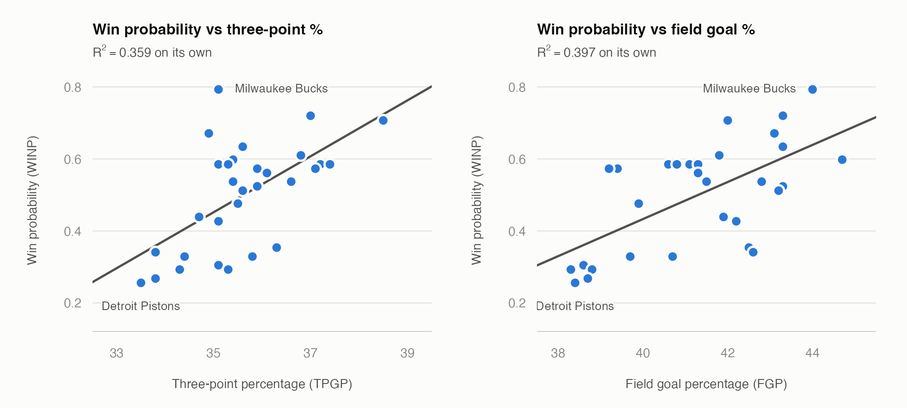
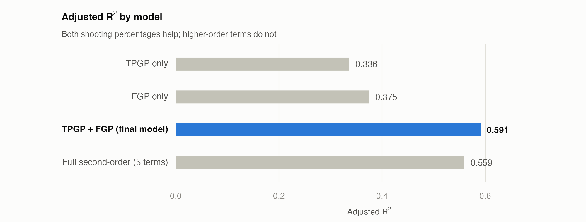
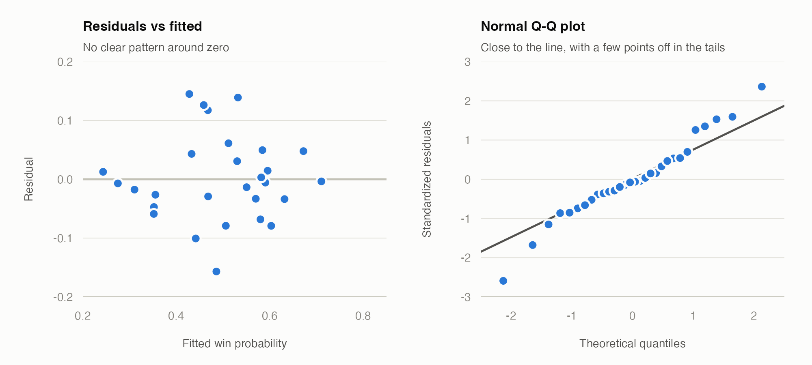

# NBA Win Probability Regression

Can two shooting percentages explain which NBA teams win? This project fits and refines a multiple linear regression on the 2018-19 season, using each team's **three-point percentage** and **field goal percentage** to predict its **win probability**.

It started as the individual final project for STAT 3000 at the University of Manitoba (Fall 2023). The goal was a careful regression workflow, from picking variables to checking assumptions, rather than a forecasting model.

**Read the write-up:** [`report/final-report.pdf`](report/final-report.pdf)

## Result

Both shooting percentages matter, and together they explain about 59% of the variation in win probability across the 30 teams.

```
WINP = -3.497 + 0.0627 * TPGP + 0.0427 * FGP
```

| Model | R² | Adjusted R² |
| --- | --- | --- |
| `WINP ~ TPGP` | 0.359 | 0.336 |
| `WINP ~ FGP` | 0.397 | 0.375 |
| **`WINP ~ TPGP + FGP` (final)** | **0.619** | **0.591** |
| Full second-order model (5 terms) | 0.635 | 0.559 |

- **What the coefficients say.** Holding field goal percentage fixed, one more percentage point of three-point shooting goes with about 6 percentage points more win probability (0.063). One more point of field goal percentage, holding three-point percentage fixed, goes with about 4 (0.043).
- **Both predictors earn their place.** Each is significant in the final model (p = 0.000476 for `TPGP`, p = 0.000203 for `FGP`), and the pair fits better than either alone. The two are only weakly correlated (r = 0.22), so each adds information the other doesn't.
- **The extra terms don't help.** Adding squared and interaction terms barely raises R² and lowers adjusted R². A partial F-test finds no evidence they matter (p = 0.7845).
- **Overall fit.** F(2, 27) = 21.9, p < 0.00001, and a typical prediction is off by about 0.095 in win probability.







## Data

[`data/NBA_Statistics.csv`](data/NBA_Statistics.csv) has one row for each of the 30 NBA teams in the 2018-19 season.

| Column | Meaning |
| --- | --- |
| `Team` | Team name |
| `WINP` | Win probability (games won / games played) |
| `TPGP` | Three-point goal percentage |
| `FGP` | Field goal percentage |

Source: [NBA.com stats](https://stats.nba.com/).

## Method

1. Fit `WINP ~ TPGP`, `WINP ~ FGP` and `WINP ~ TPGP + FGP` and compare them.
2. Fit the full second-order model and F-test whether any term matters.
3. Refine it. The squared and interaction terms are almost perfectly collinear with the predictors (VIFs above 2,400 in the full model), so drop `TPGP*FGP` and then `FGP^2`, the terms with the largest VIF, and finally `TPGP^2`, since no higher-order term was significant.
4. Compare the reduced and full models with a partial F-test.
5. Check the residual plot and the normal quantile plot for the final model.

## Limitations

- **Small sample.** There are only 30 teams from one season.
- **No hold-out data.** The fit and the R² values are in-sample, so they say how well the model describes this season, not how well it would predict the next one.
- **Association, not cause.** Shooting efficiency tracks winning, but this analysis can't say that raising it would produce wins. Winning teams may also simply get better shots.
- **Mild departures from normality.** The Q-Q plot shows a few residuals off the line in the tails.

## Repository layout

```
data/        NBA_Statistics.csv
proposal/    part1-proposal.Rmd and its PDF (Part 1: data set and model criteria)
report/      final-report.Rmd and its PDF (full analysis and write-up)
scripts/     exploratory-models.R (first model fits) and make-figures.R (README figures)
figures/     PNGs used in this README
```

## Reproducing

Requires R with the `rmarkdown`, `knitr` and `car` packages and a LaTeX engine. `make-figures.R` uses `ragg` if it is installed.

```r
# from the repository root
rmarkdown::render("report/final-report.Rmd")
rmarkdown::render("proposal/part1-proposal.Rmd")
source("scripts/exploratory-models.R")
source("scripts/make-figures.R")
```

The R Markdown files read the data with a path relative to their own folder, so knit them from where they are.
